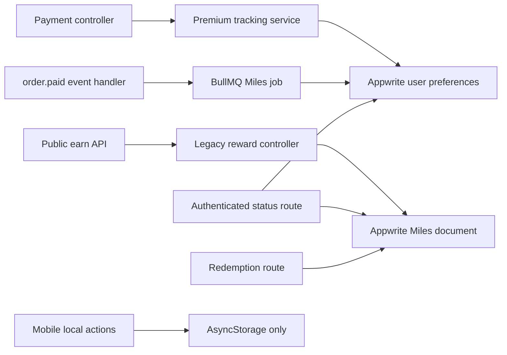

# Nile Miles System Audit

## 1. Executive Summary

Nile Miles is implemented as several overlapping balance mutation paths, not as one loyalty accounting system. A queued worker calculates purchase miles at one mile per 10 currency units, with a 2x multiplier when its job payload marks an order premium. (`Backend/src/jobs/workers/nileMilesWorker.js:28-42`)

The worker reads and writes `nileMiles` in Appwrite user preferences, while redemption reads and writes a separate Appwrite document field named `currentMiles`. (`Backend/src/jobs/workers/nileMilesWorker.js:51-69`; `Backend/controllers/UserControllers/redeemController.js:14-20,94-132`)

A second purchase path in the payment controller writes `nileMiles` and `totalMilesEarned` to preferences, and optionally creates a transaction document. (`Backend/controllers/AdminControllers/PaymentController.js:211-216,608-612`; `Backend/services/premiumOrderTrackingService.js:121-155`)

Several public reward routes accept caller supplied user identifiers without route authentication. Authenticated preference update routes also accept arbitrary preference fields and a route supplied user identifier without checking it against the authenticated identity. (`Backend/routes/reward.js:19-34`; `Backend/routes/userRoutes.js:93-119,156-180`)

The repository contains no configured append only Miles ledger, reversal flow, complete collection schema, or usable reconciliation path. (`NOT FOUND IN CODEBASE`; mutable updates: `Backend/controllers/UserControllers/redeemController.js:104-132`; `Backend/src/jobs/workers/nileMilesWorker.js:60-69`)

**Maturity assessment: MVP with material integrity and authorization gaps.** This assessment is an engineering conclusion from the cited implementation, not a claim about production deployment configuration.

## Implementation Status Matrix

| Feature | Status | Evidence |
|---|---|---|
| Purchase award through the public earn route | IMPLEMENTED | The unauthenticated route passes body supplied `userId` and `amount` to the controller. `Backend/routes/reward.js:19-27`; `Backend/controllers/AdminControllers/rewardController.js:5-45` |
| Purchase award through payment processing | IMPLEMENTED | Payment processing calls `awardMilesToUser`; the service updates user preferences. `Backend/controllers/AdminControllers/PaymentController.js:211-216,608-612`; `Backend/services/premiumOrderTrackingService.js:121-155` |
| Queued `order.paid` award path | PARTIAL | The worker handles `order.paid` and enqueues a Miles job, but no producer call to `orderEventsQueue.add` was found in the repository. The worker is loaded by the backend. `Backend/src/jobs/workers/orderEventsWorker.js:89-100`; `Backend/src/index.js:998`; `NOT FOUND IN CODEBASE` for a producer |
| Premium purchase multiplier | IMPLEMENTED | Premium calculation doubles base Miles in the queue worker and the separate premium service. `Backend/src/jobs/workers/nileMilesWorker.js:40-42`; `Backend/services/premiumOrderTrackingService.js:76-112` |
| Current balance read | IMPLEMENTED | Authenticated status route reads the caller's prefs first and falls back to a Miles collection document. `Backend/routes/reward.js:30`; `Backend/controllers/UserControllers/rewardstatus.js:7-42` |
| Reward redemption | IMPLEMENTED | Active reward document lookup, balance check, subtraction, and history write exist. `Backend/controllers/UserControllers/redeemController.js:73-132` |
| Reward used marking | IMPLEMENTED, UNAUTHENTICATED | The handler updates a matching item in the document selected by body supplied `userId`. `Backend/routes/reward.js:31`; `Backend/controllers/UserControllers/redeemController.js:146-179` |
| Referral award | PARTIAL / DEAD | Exported helper can award 50 Miles, but a call to `handleReferralSignup` was not found. `Backend/controllers/AdminControllers/rewardController.js:97-119`; `NOT FOUND IN CODEBASE` for a caller |
| Mobile engagement Miles | PARTIAL / LOCAL ONLY | The mobile context calculates and stores Miles in AsyncStorage; its backend call only reads status. `Mobileapp/Context/SocialContext.js:34-79,89-163` |
| Expiry and formal loyalty tiers | ABSENT | `NOT FOUND IN CODEBASE` |
| Refund or cancellation reversal | ABSENT | Cancellation event logs and notifies; no Miles reversal is present in that case. `Backend/src/jobs/workers/orderEventsWorker.js:191-225`; `NOT FOUND IN CODEBASE` for reversal logic |
| Durable Miles ledger and durable award idempotency | ABSENT | The worker mutates a preference balance. Its job ID is the only visible deduplication for that path. `Backend/src/jobs/workers/nileMilesWorker.js:51-69`; `Backend/src/jobs/workers/orderEventsWorker.js:91-100` |
| Appwrite Miles collection schema and ACL | UNVERIFIABLE FROM CODE | The code references collection IDs but repository schema and permission declarations were not found. `Backend/src/env.js:11-15`; `NOT FOUND IN CODEBASE` |

## 2. Architecture Map

### Components and data flow

1. `POST /api/nilemiles/earn` accepts body supplied `userId` and `amount`, then mutates the Miles collection document. (`Backend/src/index.js:762`; `Backend/routes/reward.js:19-27`; `Backend/controllers/AdminControllers/rewardController.js:5-45`)
2. Payment controller paths calculate premium savings and call `awardMilesToUser`, which updates Appwrite user preferences. (`Backend/controllers/AdminControllers/PaymentController.js:211-216,608-612`; `Backend/services/premiumOrderTrackingService.js:121-155`)
3. A loaded order event worker has an `order.paid` case that enqueues a BullMQ Miles job. The repository search found no producer for that order event queue. (`Backend/src/index.js:998`; `Backend/src/jobs/workers/orderEventsWorker.js:89-100`; `NOT FOUND IN CODEBASE` for `orderEventsQueue.add`)
4. The Miles worker reads and updates Appwrite user preferences, then emits a log event. (`Backend/src/jobs/workers/nileMilesWorker.js:51-89`)
5. The redemption controller reads a Miles collection record, checks `currentMiles`, then updates that document and serialized redemption history. (`Backend/controllers/UserControllers/redeemController.js:94-132`)
6. The status route first reads `nileMiles` from preferences and returns empty histories when it finds a numeric preference balance. Otherwise it reads the Miles collection document. (`Backend/controllers/UserControllers/rewardstatus.js:7-42`)
7. Mobile has a separate local earning and spending state in AsyncStorage. (`Mobileapp/Context/SocialContext.js:89-163`)

### Balance source of truth

There is no single source of truth in the code.

1. The status endpoint uses `users.get(userId).prefs.nileMiles` whenever it parses as a finite number, including zero. It then returns `totalMilesEarned` from prefs or defaults that value to the current balance. (`Backend/controllers/UserControllers/rewardstatus.js:7-19`)
2. The status endpoint falls back to the Miles collection only when the preference balance is not finite. (`Backend/controllers/UserControllers/rewardstatus.js:21-42`)
3. Redemption always uses the Miles collection's `currentMiles`, not the preference balance. (`Backend/controllers/UserControllers/redeemController.js:94-132`)
4. The queue worker updates `nileMiles` in preferences, while the payment award service updates both `nileMiles` and `totalMilesEarned` in preferences. (`Backend/src/jobs/workers/nileMilesWorker.js:60-69`; `Backend/services/premiumOrderTrackingService.js:126-155`)

This is mutable balance storage in more than one place, not a balance derived from an append only ledger. (`Backend/controllers/UserControllers/redeemController.js:104-132`; `Backend/src/jobs/workers/nileMilesWorker.js:60-69`)

## 3. Data Model

The following fields and types are inferred only from values read or written by code. The actual Appwrite attribute types, sizes, indexes, and ACLs are not available in the repository.

| Store | Fields seen in code | Storage and relationships | Schema, indexes, permissions |
|---|---|---|---|
| Appwrite Auth user preferences | `nileMiles`, `totalMilesEarned`, `lastMilesAwardedAt`, `lastMilesAwardedOrderId`, `lastMilesUpdate`, `isPremium` | Mutable number values represented as numbers or strings. There is no ledger relationship. `Backend/src/jobs/workers/nileMilesWorker.js:60-69`; `Backend/services/premiumOrderTrackingService.js:126-155`; `Backend/controllers/UserControllers/rewardstatus.js:7-19` | Attribute schema and ACL are not applicable to preferences in the same way as database collection attributes. Appwrite project configuration and direct client session setup are not present. `NOT FOUND IN CODEBASE` |
| Nile Miles collection | `userId`, `currentMiles`, `earnedHistory`, `redeemed`, `lastEarned` | `currentMiles` is a mutable number. `earnedHistory` and `redeemed` are JSON serialized strings in the code paths that write them. Records are looked up by `userId`. `Backend/controllers/AdminControllers/rewardController.js:5-45,51-90`; `Backend/controllers/UserControllers/redeemController.js:14-20,104-132` | Actual field types, configured string lengths, indexes, and collection permissions are `NOT FOUND IN CODEBASE` |
| Reward collection | `key`, `active`, `miles`, `name`, `image`, `category`, `description` | Reward lookup uses `key` and `active`; active catalog reads order by Miles. `Backend/controllers/UserControllers/redeemController.js:78-92,181-226` | Schema, index declarations, and collection permissions are `NOT FOUND IN CODEBASE` |
| Referral collection | `code`, `userId`, `successful` | Referral helper finds by `code`, then increments `successful`; referral reward reads query by `userId`. `Backend/controllers/AdminControllers/rewardController.js:97-119,151-167` | Schema, index declarations, and collection permissions are `NOT FOUND IN CODEBASE` |
| Optional Miles transactions collection | `userId`, `amount`, `type`, `description`, `orderId`, `createdAt` | Created only when both database ID and transaction collection setting are truthy; errors are logged and do not fail the award. `Backend/services/premiumOrderTrackingService.js:141-155` | No schema, ACL, or completeness guarantee is present in code. `NOT FOUND IN CODEBASE` |

No code limits the number of entries serialized into `earnedHistory` or `redeemed`. (`Backend/controllers/AdminControllers/rewardController.js:10-26,55-71`; `Backend/controllers/UserControllers/redeemController.js:107-132`)

### Requested size comparison

**Verdict: UNVERIFIABLE FROM CODE.** The repository does not define these collection attributes or their configured string size. It therefore cannot establish the maximum history size or compare it to the deployed Appwrite attribute limit. `Backend/controllers/UserControllers/redeemController.js:107-132` shows serialization without a length cap; `NOT FOUND IN CODEBASE` for the collection schema or attribute size.

For a safe manual check, you can inspect the configured attribute type and size in the Appwrite Console for the staging project's Miles collection. Use a disposable staging document to test a serialized history near that configured maximum. Do not run boundary writes against production. The effective size limit is a deployment setting, so it must be read from that project rather than inferred from this repository.

## 4. Earning Rules

### Public earn route

1. Trigger: direct HTTP request to `POST /api/nilemiles/earn`. (`Backend/src/index.js:762`; `Backend/routes/reward.js:19-27`)
2. Inputs: request body supplies `userId` and `amount`; the route passes them directly to `addNileMilesOnPurchase`. (`Backend/routes/reward.js:19-27`)
3. Formula: `Math.floor(amountSSPP / 10)`. (`Backend/controllers/AdminControllers/rewardController.js:5-7`)
4. Storage: increments `currentMiles` and appends a purchase object to `earnedHistory`; creates a document if one was not found. (`Backend/controllers/AdminControllers/rewardController.js:8-45`)
5. Authorization: the route has no authentication middleware. (`Backend/routes/reward.js:19-27`)
6. Validation and caps: no amount type, nonnegative check, maximum, payment confirmation, or idempotency check is visible in this route/controller. (`Backend/routes/reward.js:19-27`; `Backend/controllers/AdminControllers/rewardController.js:5-45`)

### Payment controller award path

Payment handling checks premium status on the server, calculates Miles from a cart subtotal, and calls `awardMilesToUser`. Premium receives twice the floored subtotal divided by ten. (`Backend/controllers/AdminControllers/PaymentController.js:186-216,581-612`; `Backend/services/premiumOrderTrackingService.js:11-63,76-112`)

The service reads `nileMiles` and `totalMilesEarned`, updates both preferences, and attempts to create an optional transaction record. Transaction logging failure is caught and does not fail the award operation. (`Backend/services/premiumOrderTrackingService.js:121-155`)

### Queued worker path

The order event worker passes `order.total` and `order.isPremiumOrder` to the Miles queue under job ID `miles:${order.$id}`. (`Backend/src/jobs/workers/orderEventsWorker.js:89-100`) The Miles worker calculates `Math.floor(orderTotal / 10)` and doubles it when the job payload's `isPremium` is true. (`Backend/src/jobs/workers/nileMilesWorker.js:28-44`)

The queue worker is loaded by the server, but this repository does not show code that publishes `order.paid` events to the order events queue. Thus the worker's handler is present, but the full order to event to award reachability is not established from repository code. (`Backend/src/index.js:998`; `NOT FOUND IN CODEBASE` for an order event producer)

### Referral and mobile engagement

`handleReferralSignup` can award a fixed 50 Miles to the inviter and increment a success counter. No code caller for the helper was found, so treat it as partial or dead, not as an established signup entitlement. (`Backend/controllers/AdminControllers/rewardController.js:97-119`; `NOT FOUND IN CODEBASE` for a caller)

Mobile action rates are defined for likes, shares, video watching, referral, first purchase, and daily login. `earnMiles` changes local context state and AsyncStorage. The only backend interaction in the context reads status. (`Mobileapp/Context/SocialContext.js:21-79,89-163`)

## 5. Redemption and Spending Rules

1. `redeemMiles` receives `userId` and `rewardKey` from the request body. (`Backend/controllers/UserControllers/redeemController.js:73-78`)
2. It queries the reward collection for a matching active reward, then loads the Miles document for the body supplied user ID. (`Backend/controllers/UserControllers/redeemController.js:78-99`)
3. It checks `currentMiles < reward.miles`, computes `newMiles`, appends a redemption object, and writes the balance and serialized redemption history. (`Backend/controllers/UserControllers/redeemController.js:100-132`)
4. The API does not validate caller ownership, require authentication, or use an idempotency key. (`Backend/routes/reward.js:29`; `Backend/controllers/UserControllers/redeemController.js:73-132`)
5. `markRewardAsUsed` receives body supplied `userId` and `redeemedRewardName`, finds the first matching unused history item, marks it used, and writes the history. (`Backend/controllers/UserControllers/redeemController.js:146-179`)
6. Neither handler ties the redemption to an order, a physical reward fulfillment, or a payment transaction. `NOT FOUND IN CODEBASE` for such a link.
7. Failure responses include 400 for invalid input, inactive rewards, insufficient Miles, or missing/used rewards, 404 for a missing Miles record, and 500 on caught errors. (`Backend/controllers/UserControllers/redeemController.js:77-103,146-179`)

An earlier exported `redeemMile` implementation uses an in-file reward constant, but the route imports and calls `redeemMiles`, so `redeemMile` is not the route's active handler. (`Backend/controllers/UserControllers/redeemController.js:6-12,23-70`; `Backend/routes/reward.js:13-29`)

## 6. Tiers, Expiry, Streaks, Referrals, Bonuses

| Feature | Status and evidence |
|---|---|
| Formal server Miles tiers | DESIGNED BUT ABSENT. `NOT FOUND IN CODEBASE`. Mobile has a local `calculateLevel` helper only. `Mobileapp/Context/SocialContext.js:164-180` |
| Miles expiration | ABSENT. No expiration field or expiry worker was found for Miles. `NOT FOUND IN CODEBASE` |
| Social daily limits | PARTIAL, local only. The context resets action counts based on device date and applies local counters. `Mobileapp/Context/SocialContext.js:14-32,89-153` |
| Referral award | PARTIAL / DEAD. The exported helper awards 50 Miles and increments `successful`, but its caller was not found. `Backend/controllers/AdminControllers/rewardController.js:97-119`; `NOT FOUND IN CODEBASE` for a caller |
| Premium earning bonus | IMPLEMENTED in the payment and queue calculation code paths. `Backend/services/premiumOrderTrackingService.js:76-112`; `Backend/src/jobs/workers/nileMilesWorker.js:40-42` |
| First account bonus | ABSENT. `NOT FOUND IN CODEBASE` |
| Refund, return, or chargeback bonus reversal | ABSENT. `NOT FOUND IN CODEBASE` |

## 7. Lifecycle Walkthroughs

### Order placed, payment confirmed, Miles earned

The payment controller's premium processing path determines a user ID from request identity or a fallback, checks the user's premium status, calculates savings from the cart, updates premium fields on the order, and calls the preference based award service. (`Backend/controllers/AdminControllers/PaymentController.js:186-216,581-612`; `Backend/services/premiumOrderTrackingService.js:11-63,76-112,121-155,181-213`)

Separately, the queued worker path handles an `order.paid` event, enqueues a `miles:${order.$id}` job, and the Miles worker adds the calculated amount to preference balance. The enqueue logic is present, but a producer for `order.paid` was not found. (`Backend/src/jobs/workers/orderEventsWorker.js:89-100`; `Backend/src/jobs/workers/nileMilesWorker.js:25-89`; `NOT FOUND IN CODEBASE` for an order event producer)

These are separate implementations and storage paths. The repository does not prove that one order will trigger both, so a duplicate award across those two paths is a risk to investigate, not a verified occurrence.

### Cancellation, refund, or return

The `order.cancelled` event writes an `ORDER_CANCELLED` audit log and sends a notification. It does not update a Miles balance. (`Backend/src/jobs/workers/orderEventsWorker.js:191-225`) A Miles reversal handler for cancellation, refund, return, or chargeback was not found. (`NOT FOUND IN CODEBASE`)

### Miles redeemed

The request calls `POST /api/nilemiles/redeem`; the controller loads the reward and caller selected user's Miles document, checks balance, then writes the reduced balance and updated JSON history. (`Backend/routes/reward.js:29`; `Backend/controllers/UserControllers/redeemController.js:73-132`)

### Account creation and first time bonus

A Miles first time award on account creation was not found. (`NOT FOUND IN CODEBASE`)

### Referral

The referral helper finds a code, awards 50 Miles to its owner, then increments `successful`. The helper is not called from an account creation route in the repository search, so the end to end signup flow is not verified. (`Backend/controllers/AdminControllers/rewardController.js:97-119`; `NOT FOUND IN CODEBASE` for a caller)

## 8. API Surface

The Nile Miles router is mounted at `/api/nilemiles`. (`Backend/src/index.js:762`) Authentication below refers to middleware declared on the route itself. No route level role check or rate limiter is declared in this router. (`Backend/routes/reward.js:19-34`)

| Method and path | User ID source | Authentication chain | Validation and idempotency |
|---|---|---|---|
| POST `/api/nilemiles/earn` | Body `userId`; body `amount` | None | No visible input validation beyond downstream behavior. No idempotency key. `Backend/routes/reward.js:19-27` |
| POST `/api/nilemiles/redeem` | Body `userId`; body `rewardKey` | None | Checks required values, active reward, record existence, balance. No ownership check or idempotency key. `Backend/routes/reward.js:29`; `Backend/controllers/UserControllers/redeemController.js:73-132` |
| GET `/api/nilemiles/nilemiles/status` | Authenticated session, `req.user.userId` | `authenticateToken` then `getNileMilesStatus` | The middleware verifies a token and attaches `decoded.sub` as `req.user.userId`; no role specific check in the route. `Backend/routes/reward.js:30`; `Backend/middleware/authMiddleware.js:89-94`; `Backend/controllers/UserControllers/rewardstatus.js:7-19` |
| POST `/api/nilemiles/mark-reward-used` | Body `userId`; body `redeemedRewardName` | None | Checks required values and unused matching reward. No ownership check or idempotency key. `Backend/routes/reward.js:31`; `Backend/controllers/UserControllers/redeemController.js:146-179` |
| GET `/api/nilemiles/:userId/rewards` | Path parameter `userId` | None | Reads that user's Miles history and referral code. No ownership check. `Backend/routes/reward.js:32`; `Backend/controllers/AdminControllers/rewardController.js:123-167` |
| GET `/api/nilemiles/nilemiles/rewards/grouped` | No user ID | None | Reads active reward catalog. `Backend/routes/reward.js:33`; `Backend/controllers/UserControllers/redeemController.js:205-226` |
| GET `/api/nilemiles/nilemiles/rewards` | No user ID | None | Reads active reward catalog. `Backend/routes/reward.js:34`; `Backend/controllers/UserControllers/redeemController.js:181-203` |

### User preference routes relevant to Miles

`userRoutes` is mounted at `/api/users`. (`Backend/src/index.js:746-747`)

The PUT handler is therefore mounted as `/api/users/users/:userId/preferences`; it requires `authenticateToken`, takes `userId` from the path and `preferences` from the body, then calls `users.updatePrefs` without comparing the path ID to `req.user.userId`. (`Backend/routes/userRoutes.js:93-119`; `Backend/src/index.js:747`)

The PATCH handler is mounted as `/api/users/api/users/:userId/preferences`; it requires `authenticateToken`, merges the entire body over existing preferences, and calls `users.updatePrefs`, again without comparing the path ID to `req.user.userId` or restricting fields. (`Backend/routes/userRoutes.js:156-180`; `Backend/src/index.js:747`)

The auth middleware sets `req.user.userId` from the token subject, but these handlers do not use that identity for ownership checks. (`Backend/middleware/authMiddleware.js:89-94`; `Backend/routes/userRoutes.js:93-119,156-180`)

## 9. Integrations and Dependencies

1. The backend creates an Appwrite `Client`, sets project and endpoint configuration, and applies the server API key before creating `Users` and `Databases` clients. (`Backend/services/appwriteService.js:1-30`; `Backend/src/env.js:11-15`)
2. BullMQ queues use Redis when configured. Miles jobs inherit three attempts, exponential backoff, removal of completed jobs after retaining 100, and retention of up to 500 failed jobs. (`Backend/src/jobs/queues/index.js:68-72,123-128`)
3. The payment controller imports premium tracking operations and invokes them at payment processing locations. (`Backend/controllers/AdminControllers/PaymentController.js:12-23,211-216,608-612`)
4. A frontend `appwrite` dependency exists in the AdminDashboard manifest, but no direct Appwrite SDK import or `Account.updatePrefs` call was found in current AdminDashboard, Mobileapp, Website2, VendorDashboard, or RiderDashboard source. The mobile context uses an HTTP client for Miles status. (`AdminDashboard/package.json:18`; `Mobileapp/Context/SocialContext.js:1-3,34-44`; `NOT FOUND IN CODEBASE` for direct frontend preference SDK use)
5. No Miles specific payment provider callback, analytics event, or notification is present in the award calculation beyond order worker notifications and the `MILES_AWARDED` application log. (`Backend/src/jobs/workers/orderEventsWorker.js:89-144`; `Backend/src/jobs/workers/nileMilesWorker.js:71-89`)
6. The local `Backend/.env` file contains an Appwrite credential at line 7. Its value is intentionally omitted here. Git reports that this file is not tracked. (`Backend/.env:7`; local `git ls-files` check returned no tracked path)

## 10. Observability

The queued award path writes a structured `MILES_AWARDED` audit log containing the order, user, amounts, calculated Miles, resulting balance, premium flag, and timestamp. (`Backend/src/jobs/workers/nileMilesWorker.js:71-89`)

The optional transaction document records a limited set of values for the payment service award path, but creation can fail without failing the award. It is not a guaranteed ledger. (`Backend/services/premiumOrderTrackingService.js:141-155`)

Redemption catches and logs exceptions to console, but successful redemptions are represented by rewriting the mutable balance and JSON history rather than an immutable audit event. (`Backend/controllers/UserControllers/redeemController.js:123-140,172-188`)

An engineer cannot reliably reconstruct the current balance from durable records. The status API may return only a preference balance and empty histories, while redemption mutates a separate document. (`Backend/controllers/UserControllers/rewardstatus.js:11-19`; `Backend/controllers/UserControllers/redeemController.js:123-132`)

No Miles specific reconciliation, repair, or backfill job was found. (`NOT FOUND IN CODEBASE`)

## 11. Tests

The named Nile Miles route test only checks that routers load. (`Backend/tests/rewardRouteLoading.test.js:1-8`)

Tests for award formulas, authenticated ownership, direct preference mutation, duplicate event delivery, redemption concurrency, cancellation reversal, expiry, or attribute length failure were not found. (`NOT FOUND IN CODEBASE`)

## Focused Verification of Requested Claims

### 1. Can an authenticated end user write Miles preferences through the client SDK?

**Direct Appwrite client SDK verdict: UNVERIFIABLE FROM CODE.** No product app source use of the Appwrite Account SDK or `Account.updatePrefs` was found. An `appwrite` package dependency is declared for AdminDashboard, but no client source use was found. (`AdminDashboard/package.json:18`; `NOT FOUND IN CODEBASE` for frontend `Account.updatePrefs` use) The actual project's Appwrite settings and whether a user has a valid Appwrite client session are not in repository configuration. (`Backend/src/env.js:11-15`; no client project configuration found)

**Backend preference API verdict: CONFIRMED.** Any request accepted by `authenticateToken` can pass a path `userId` and arbitrary fields to the privileged Appwrite Users API. The handlers do not bind the path ID to the authenticated token identity and do not allowlist preference keys. This includes `nileMiles`, `totalMilesEarned`, and `isPremium`. (`Backend/routes/userRoutes.js:93-119,156-180`; `Backend/middleware/authMiddleware.js:89-94`; `Backend/src/index.js:747`)

Manual check, only with a disposable account and staging Appwrite project:

1. Sign in to the staging app and obtain its authenticated API token. Do not use a production account or production token.
2. Save the test account's existing preference values through the trusted profile interface or staging Appwrite Console.
3. Send a PATCH request to `/api/users/api/users/<test-user-id>/preferences` with the same account's bearer token and body `{"nileMiles":"987654","totalMilesEarned":"987654"}`. The path includes the duplicated `/api/users` because of the router mount and route path. (`Backend/src/index.js:747`; `Backend/routes/userRoutes.js:156-180`)
4. Read the test account preferences from the staging Console or a session bound Appwrite `Account.getPrefs` call. Then read the backend status endpoint and compare values. (`Backend/routes/reward.js:30`; `Backend/controllers/UserControllers/rewardstatus.js:7-19`)
5. Restore the saved values or delete the test fields. To test direct SDK access separately, use the project's real authenticated client session and attempt the SDK's current user's preference update on that disposable account. The result depends on project configuration not in this repository.

### 2. Source of `userId` and middleware per reward endpoint

The full route table is in Section 8. Only the status endpoint has route local authentication, and it derives identity from the verified session subject. (`Backend/routes/reward.js:19-34`; `Backend/middleware/authMiddleware.js:89-94`) The other endpoints take a body or path identifier, with no ownership middleware declared in this router. (`Backend/routes/reward.js:19-34`)

### 3. Does redemption verify ownership?

**Verdict: REFUTED.** `redeemMiles` and `markRewardAsUsed` accept `userId` from the request body and use it to find a document. Neither is authenticated in the route table, and neither compares the target user ID to a verified caller identity. (`Backend/routes/reward.js:29,31`; `Backend/controllers/UserControllers/redeemController.js:73-99,146-179`)

### 4. Is redemption atomic?

**Verdict: REFUTED.** The implementation performs a document read, a balance check, computes a new balance in process memory, and later calls `updateDocument`; no transaction, conditional version check, or atomic decrement is shown. (`Backend/controllers/UserControllers/redeemController.js:94-132`)

Concrete interleaving: suppose the record has 500 Miles and a reward costs 500. Request A reads 500 and passes the check. Request B also reads 500 and passes. Each computes zero and writes zero, but each returns reward success. Two rewards are issued for one 500 Miles balance. The interleaving follows the independent read/check/write sequence at `Backend/controllers/UserControllers/redeemController.js:94-132`.

### 5. Is idempotency durable after the BullMQ job is removed?

**Verdict: REFUTED.** The producer sets job ID `miles:${order.$id}` and comments it as idempotent. (`Backend/src/jobs/workers/orderEventsWorker.js:91-100`) Completed jobs are removed after the queue retains 100; once removed, BullMQ no longer has that job ID as a retained duplicate to reject. (`Backend/src/jobs/queues/index.js:68-72`) The Miles worker does not query or persist an award receipt before applying the balance delta; `lastMilesAwardedOrderId` is written but not checked. (`Backend/src/jobs/workers/nileMilesWorker.js:60-69`)

Thus, if an `order.paid` event is replayed after removal, the event handler can enqueue the same ID again and the worker can award again. This is a verified property of the visible queue and worker code, conditional on that event being redelivered. (`Backend/src/jobs/workers/orderEventsWorker.js:89-100`; `Backend/src/jobs/queues/index.js:68-72`; `Backend/src/jobs/workers/nileMilesWorker.js:51-89`)

### 6. Who can write `isPremiumOrder` and `isPremium`?

`isPremiumOrder` is written by `updateOrderWithPremiumData`, which receives values calculated by `calculatePremiumSavings`; payment controller code obtains premium status by calling `checkUserPremiumStatus` before this calculation. (`Backend/services/premiumOrderTrackingService.js:11-63,76-82,181-213`; `Backend/controllers/AdminControllers/PaymentController.js:186-216,581-612`) The order event worker reads the stored field and copies it into the Miles job payload. (`Backend/src/jobs/workers/orderEventsWorker.js:91-100`) No direct end user writer for that order field was found; deployed collection permissions are unknown. (`NOT FOUND IN CODEBASE` for the collection ACL)

`isPremium` is set by backend subscription and payment callback handlers, and cleared by subscription expiry handling. (`Backend/controllers/subscriptionController.js:42-52,209-255,621-729`; `Backend/controllers/paymentCallbackController.js:145-154,252-263,775-807,950-961`; `Backend/utils/subscriptionCron.js:47-50`) However, the generic authenticated preference PUT and PATCH routes also accept arbitrary preference keys, including `isPremium`, and fail to verify that the target ID belongs to the caller. (`Backend/routes/userRoutes.js:93-119,156-180`) Thus a backend API caller who passes authentication can write `isPremium` through those routes; a direct client SDK write remains UNVERIFIABLE FROM CODE.

### 7. Maximum `earnedHistory` and `redeemed` size

**Verdict: UNVERIFIABLE FROM CODE.** The arrays are JSON stringified without a code level length check, but the configured Appwrite attribute size and deployed platform limit are not defined in this repository. (`Backend/controllers/AdminControllers/rewardController.js:10-26`; `Backend/controllers/UserControllers/redeemController.js:107-132`; schema: `NOT FOUND IN CODEBASE`) Inspect the staging project's actual attribute type and size in Appwrite Console to determine the configured maximum. Do not test boundary values against production.

## Loophole Register

Severity is an engineering estimate of impact based on the demonstrated code path. Conditions that depend on external Appwrite ACLs or deployment configuration are identified as such.

| ID | Title | Severity (Critical/High/Medium/Low) | Category | Evidence (file:line) | How it could be exploited | Impact | Recommended fix | Effort (S/M/L) |
|---|---|---|---|---|---|---|---|---|
| L01 | Unauthenticated caller controlled Miles earning | High | Integrity and authorization | `Backend/routes/reward.js:19-27`; `Backend/controllers/AdminControllers/rewardController.js:5-45` | A caller supplies a target `userId` and an amount not verified against a paid order. | Direct balance inflation and account value corruption. | Remove public route or require a verified paid order ID and derive the eligible amount on the server. | S |
| L02 | Unauthenticated cross user redemption and use marking | High | Authorization and theft | `Backend/routes/reward.js:29,31`; `Backend/controllers/UserControllers/redeemController.js:73-99,146-179` | A caller supplies another user's ID and redeems or marks that account's reward used. | Unauthorized depletion or consumption of another user's rewards. | Require auth, derive user ID from token, enforce ownership, and authorize fulfillment roles separately. | S |
| L03 | Authenticated arbitrary preference mutation | High | Authorization and premium abuse | `Backend/routes/userRoutes.js:93-119,156-180`; `Backend/middleware/authMiddleware.js:89-94` | A token holder targets any path user ID and supplies arbitrary preferences, including Miles and premium flags. | Users can manipulate their own or another user's loyalty and premium state. | Bind target ID to token subject; allowlist profile keys; isolate server managed fields. | S |
| L04 | No durable duplicate award protection | High | Idempotency | `Backend/src/jobs/workers/orderEventsWorker.js:91-100`; `Backend/src/jobs/queues/index.js:68-72`; `Backend/src/jobs/workers/nileMilesWorker.js:51-89` | Replay the same paid event after BullMQ removes the completed job. | Repeated Miles issuance. | Persist unique award receipt per order and use one atomic transaction for receipt and balance delta. | M |
| L05 | Redemption read check write race | High | Concurrency | `Backend/controllers/UserControllers/redeemController.js:94-132` | Two redemptions read the same balance before either writes and both pass. | Multiple rewards can be delivered for one balance. | Use atomic conditional decrement or serialized ledger transaction. | M |
| L06 | Conflicting balance stores and earning writers | High | Accounting integrity | `Backend/controllers/UserControllers/rewardstatus.js:7-42`; `Backend/controllers/UserControllers/redeemController.js:94-132`; `Backend/services/premiumOrderTrackingService.js:126-155`; `Backend/src/jobs/workers/nileMilesWorker.js:60-69` | Reads use prefs first while redemption writes the collection, and multiple award paths update different representations. | Displayed balance, spendable balance, and history can disagree. | Establish one canonical ledger and migrate all reads and writes to it. | L |
| L07 | No cancellation or refund reversal | High | Financial logic | `Backend/src/jobs/workers/orderEventsWorker.js:191-225`; `NOT FOUND IN CODEBASE` for reversal | Earn on a paid order, then cancel or refund without a compensating Miles event. | Unbacked outstanding Miles and increased reward cost. | Issue idempotent reversal entries linked to the original award and enforce spendability rules. | M |
| L08 | History strings grow without code cap | Medium | Reliability | `Backend/controllers/AdminControllers/rewardController.js:10-26`; `Backend/controllers/UserControllers/redeemController.js:107-132` | Repeated earn and redeem operations grow serialized arrays until Appwrite rejects a write at the deployment's configured limit. | Failed awards/redemptions and inability to retain complete history. | Normalize immutable entries into records and inspect deployed attribute sizes before migration. | M |
| L09 | Referral helper has no visible invocation or duplicate guard | Medium | Abuse and lifecycle | `Backend/controllers/AdminControllers/rewardController.js:97-119`; `NOT FOUND IN CODEBASE` for a caller | If wired or invoked repeatedly, the same code can cause repeated inviter credits; no unique new user receipt is visible. | Bonus farming if exposed later or called repeatedly. | Wire only through verified account creation and enforce unique referral attribution and abuse controls. | M |
| L10 | Mobile engagement balance can be locally changed | Low | Client state integrity | `Mobileapp/Context/SocialContext.js:89-163` | Local actions change AsyncStorage balance without server award mutation. | Local display drift; no evidence that it changes the backend balance. | Treat it as nonfinancial UI state or remove it from the canonical Miles display. | S |
| L11 | Credential material in local environment file | Medium | Secrets management | `Backend/.env:7` | If this local value is valid and exposed or accidentally committed, it may grant server level Appwrite access. | Unauthorized data access or modification. | Keep the value redacted, rotate if it has been exposed, and ensure environment files remain excluded from source control. | S |

## Top 10 Priority Fixes

1. **Close public reward mutation routes.** `earn`, `redeem`, and `mark-reward-used` have no authentication middleware and use caller supplied user identifiers. These routes enable direct account mutation and cross account spending. (`Backend/routes/reward.js:19-34`)
2. **Protect server managed preferences.** The authenticated PUT and PATCH handlers accept arbitrary keys and a target user ID without ownership binding. Enforce token subject ownership and allowlist user editable preferences. (`Backend/routes/userRoutes.js:93-119,156-180`)
3. **Use one authoritative balance path.** The worker and payment award update prefs, status prefers prefs, and redemption uses a different collection document. Converge reads and writes before adding new earning rules. (`Backend/controllers/UserControllers/rewardstatus.js:7-42`; `Backend/controllers/UserControllers/redeemController.js:94-132`; `Backend/services/premiumOrderTrackingService.js:126-155`)
4. **Add durable paid order idempotency.** BullMQ retains only a bounded set of completed jobs and the worker does not check an award receipt. Store a unique award key per order and reject duplicates even after queue cleanup. (`Backend/src/jobs/queues/index.js:68-72`; `Backend/src/jobs/workers/nileMilesWorker.js:51-69`)
5. **Make redemptions atomic.** The current check and update are separate operations. Use an atomic conditional debit or transaction so concurrent requests cannot both spend the same balance. (`Backend/controllers/UserControllers/redeemController.js:94-132`)
6. **Add reversal events.** The cancellation event currently logs and notifies but does not reverse Miles. Link refunds, returns, and chargebacks to original awards and post compensating entries. (`Backend/src/jobs/workers/orderEventsWorker.js:191-225`)
7. **Remove caller control of earning amount.** Award only after the backend validates a paid order and derives its eligible subtotal; the current public endpoint accepts `amount` directly. (`Backend/routes/reward.js:19-27`; `Backend/controllers/AdminControllers/rewardController.js:5-7`)
8. **Replace mutable JSON history with normalized ledger entries.** The current arrays are rewritten on each change, grow over time, and are not sufficient accounting records. (`Backend/controllers/AdminControllers/rewardController.js:10-26`; `Backend/controllers/UserControllers/redeemController.js:107-132`)
9. **Verify Appwrite deployment configuration.** Collection schema and permissions are external to this repo, so inspect staging and production configuration separately and record the effective access rules and attribute sizes. (`Backend/src/env.js:11-15`; schema and ACL: `NOT FOUND IN CODEBASE`)
10. **Add focused regression tests and reconcile.** The existing route test only verifies loading. Add tests for auth, ownership, idempotency, atomic redemption, reversals, and repair behavior. (`Backend/tests/rewardRouteLoading.test.js:1-8`)

## Architecture Gaps

To support 100K to 1M users, the current system needs these controls. These are recommendations, not claims that the code already provides them.

1. A single append only ledger event per award, redemption, reversal, expiry, and administrative adjustment.
2. A unique business idempotency key, such as `orderId + awardType`, stored durably and independent of queue retention.
3. Atomic balance changes, either a database transaction with a balance snapshot or an atomic conditional update supported by the chosen datastore.
4. One versioned event schema with user ID, order ID, payment reference, event type, signed Miles delta, actor, request ID, timestamp, and resulting balance.
5. Reconciliation between paid orders, refunds, ledger entries, and balance snapshots, with observable mismatches and a safe repair workflow.
6. Fraud checks for repeated referrals, high award velocity, client replay, shared device signals, and reward fulfillment abuse.
7. A documented Appwrite collection schema, index plan, permissions, attribute sizes, and migration procedures.
8. A clear separation between customer editable preferences and server controlled loyalty and premium fields.

## Recommended Target Design

Keep the system in the existing backend rather than creating a separate microservice. Store each Miles change as an immutable ledger entry with a unique idempotency key and a reference to its originating order, payment, redemption, refund, or manual adjustment. Update a balance snapshot atomically with entry creation, or derive the balance from entries if the data volume and read profile permit. Route all earning, redemption, and reversal operations through one service. Derive user identity from the authenticated session, never from a request body. Add a scheduled reconciliation that compares eligible paid orders and refunds against ledger entries. This is a proposed design; the current code instead uses mutable prefs and collection fields. (`Backend/src/jobs/workers/nileMilesWorker.js:60-69`; `Backend/controllers/UserControllers/redeemController.js:104-132`; `Backend/services/premiumOrderTrackingService.js:126-155`)

## Open Questions

1. Which purchase award path is authoritative: the payment controller service, the queued event worker, or both?
2. What exact order states and payment providers qualify for earning?
3. What is the intended treatment of cancellation, refund, partial refund, return, and chargeback after Miles have been spent?
4. Are Miles intended to expire, have a maximum balance, or use campaign specific caps?
5. Is the 2x premium earning rule based on subscription status at order creation, payment confirmation, or award processing?
6. Is referral Miles an active feature, and what qualifies as a successful referral?
7. Is mobile social engagement earning meant to affect the same spendable Miles balance?
8. Which Appwrite project and collection schema is authoritative, including attribute sizes, indexes, and ACLs?
9. Which roles may mark a reward as used, and what process fulfills or reverses a redemption?
10. Should user facing profiles expose `totalMilesEarned` separately from current spendable balance?
11. Has the local Appwrite credential at `Backend/.env:7` been rotated if it was ever exposed outside the local environment?

## Appendix A: File Inventory

These are the source and configuration files cited in this report. The repository-wide search also found legacy docs and unrelated files containing broad keyword matches; they are not treated as live evidence unless listed here.

| File | Audit relevance |
|---|---|
| `Backend/routes/reward.js` | Nile Miles API route registration and route middleware |
| `Backend/routes/userRoutes.js` | Authenticated preference read and update handlers |
| `Backend/middleware/authMiddleware.js` | Token validation and `req.user` construction |
| `Backend/src/index.js` | Router mount paths and worker startup |
| `Backend/controllers/UserControllers/redeemController.js` | Redemption, reward used marking, and catalog reads |
| `Backend/controllers/UserControllers/rewardstatus.js` | Balance status read behavior |
| `Backend/controllers/AdminControllers/rewardController.js` | Public earning controller, referral helper, history reads |
| `Backend/controllers/AdminControllers/PaymentController.js` | Payment paths invoking premium Miles award logic |
| `Backend/controllers/subscriptionController.js` | Premium preference updates |
| `Backend/controllers/paymentCallbackController.js` | Premium preference updates after payment callbacks |
| `Backend/services/premiumOrderTrackingService.js` | Premium check, award calculation, prefs mutation, order fields |
| `Backend/src/jobs/workers/orderEventsWorker.js` | `order.paid` enqueue and cancellation event handling |
| `Backend/src/jobs/workers/nileMilesWorker.js` | Queued Miles calculation and balance update |
| `Backend/src/jobs/queues/index.js` | BullMQ retry and retention defaults |
| `Backend/services/appwriteService.js` | Backend Appwrite client setup |
| `Backend/src/env.js` | Required Appwrite server configuration |
| `Backend/.env` | Local environment file; credential value at line 7 redacted |
| `Backend/tests/rewardRouteLoading.test.js` | Existing route loading test |
| `Mobileapp/Context/SocialContext.js` | Local engagement Miles state |
| `Mobileapp/config/config.js` | Mobile public configuration and warning that server secrets belong only on backend |
| `AdminDashboard/package.json` | Declares Appwrite client package |

## Appendix B: Appwrite Collections and Permissions

The repository references `APPWRITE_NILE_MILES_COLLECTION`, `APPWRITE_REWARD_COLLECTION_ID`, `APPWRITE_REFERRALS_COLLECTION_ID`, and optionally `APPWRITE_MILES_TRANSACTIONS_COLLECTION` in server code. (`Backend/controllers/AdminControllers/rewardController.js:20-32,66-77,98-116`; `Backend/controllers/UserControllers/redeemController.js:16-20,79-83`; `Backend/services/premiumOrderTrackingService.js:141-148`)

No collection setup file defining Miles attributes, indexes, or permissions was found. No ACL export is present. The environment schema requires general Appwrite connection values, but does not define those loyalty collection schemas. (`Backend/src/env.js:11-15`; schema and permission dump: `NOT FOUND IN CODEBASE`)

`Backend/.env:7` contains a credential value, omitted from this document. The file is not tracked by Git in the inspected worktree. Do not copy the value into this report or other logs.

## Appendix C: Events Emitted Related to Miles

| Event or operation | Location | Evidence |
|---|---|---|
| `order.paid` event case | Order event worker, then enqueue to Miles queue | `Backend/src/jobs/workers/orderEventsWorker.js:89-100` |
| `MILES_AWARDED` audit log | Miles queue worker | `Backend/src/jobs/workers/nileMilesWorker.js:71-89` |
| `ORDER_CANCELLED` audit log | Order event worker | `Backend/src/jobs/workers/orderEventsWorker.js:191-198` |
| Optional transaction document with type `earned` | Premium tracking service | `Backend/services/premiumOrderTrackingService.js:141-155` |
| Dedicated reversal event | Not found | `NOT FOUND IN CODEBASE` |
| Dedicated redemption audit event | Not found; current representation rewrites the redemption array | `Backend/controllers/UserControllers/redeemController.js:107-132,161-179`; `NOT FOUND IN CODEBASE` |
